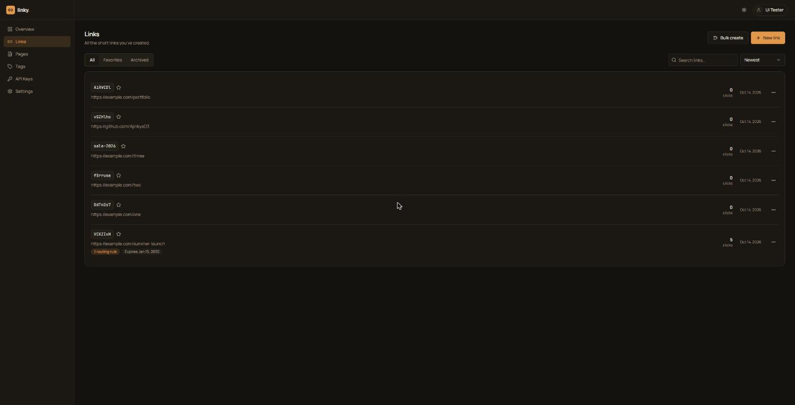
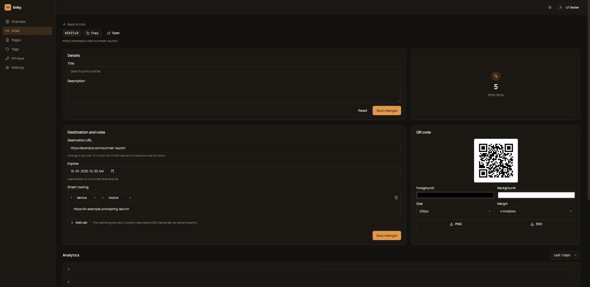
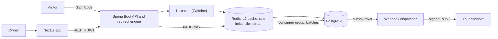

<div align="center">

# Linky

**A fast, self-hostable URL shortener with smart routing, link-in-bio pages, QR codes, analytics and signed webhooks.**

Built to show how a link shortener actually works at scale: a cache-first redirect path, an asynchronous click pipeline,
and the security and delivery engineering around it.

[](https://github.com/AjinkyaD3/linky-backend-springboot/actions/workflows/ci.yml)
[](https://github.com/AjinkyaD3/linky-frontend-nextjs/actions/workflows/ci.yml)


</div>

| Links | Link details, routing and QR | Link-in-bio page |
|---|---|---|
|  |  |  |

---

## Contents

[Features](#features) · [How it works](#how-it-works) · [Performance](#performance-measured) · [Quick start](#quick-start) ·
[Using the API](#using-the-api) · [Webhooks](#webhooks) · [Project layout](#project-layout) · [Testing and CI/CD](#testing-and-cicd) ·
[Security](#security) · [Known limitations](#known-limitations) · [Roadmap](#roadmap) · [Compared with Bitly](#compared-with-bitly)

## Features

**Links**
- Short links with random, unguessable 7-character codes, or your own alias
- **Editable destination**: change where a link points; the short code, QR code and analytics stay the same
- **Smart routing**: send visitors to different URLs by device, operating system or country
- **Expiry dates**, a **UTM builder**, and **bulk create** (up to 100 links at once)
- Tags, favourites, archive, duplicate, search

**Access control**
- **Password-protected** links, **one-time** links (exactly one visitor gets through, even under concurrent clicks), and **private** links (owner only)

**QR codes**
- Custom colours, size and margin, PNG or SVG, with a contrast warning when a code would be hard to scan

**Pages (link-in-bio)**
- One public page (`/p/your-name`) with all your links. Every button is a tracked short link.

**Analytics**
- Clicks over time, browsers, operating systems, devices, referrers, **countries and cities** (MaxMind GeoLite2 or DB-IP).
  Visitor IPs are never stored: only a salted hash.

**Webhooks**
- Signed HTTPS callbacks for `link.created` and `link.milestone` with retries and backoff, automatic disabling of dead endpoints, SSRF protection and a delivery log

**Platform**
- JWT auth with rotating refresh tokens, API keys, Redis-backed rate limiting, Swagger UI, Prometheus metrics, structured logs, Flyway migrations, a full CI/CD pipeline

## How it works



**The redirect path.** `GET /{code}` is resolved through a two-level cache (in-memory, then Redis, then Postgres), with
negative caching for unknown codes and single-flight loading so a hot key cannot stampede the database. The cached object carries
everything needed to decide the outcome (expired? private? password? one-time? routing rules?), so a cache hit needs **no database query**.
The click is published to a Redis Stream with a single `XADD` and the visitor gets a `302`.

**The click pipeline.** A consumer group on every instance reads the stream in batches, parses the user agent and location,
does one JDBC batch insert and one counter update per link, then acknowledges. Delivery is at-least-once, with reclaim of
entries from crashed consumers and dead-lettering of poison events. Clicks buffer in the stream if the database is down.

**One-time links** are claimed with a single conditional `UPDATE ... WHERE is_active = true`, so the database decides the single winner.

**Webhooks** use a transactional outbox: the event row is written in the same transaction as the change, and a worker on every
instance claims due rows with `FOR UPDATE SKIP LOCKED`, signs the body (HMAC-SHA256) and retries with backoff.

More detail: [scaling notes](https://github.com/AjinkyaD3/linky-backend-springboot/blob/main/docs/SCALING.md),
[webhooks](https://github.com/AjinkyaD3/linky-backend-springboot/blob/main/docs/WEBHOOKS.md),
[geo analytics](https://github.com/AjinkyaD3/linky-backend-springboot/blob/main/docs/GEOIP.md),
[CI/CD](docs/CICD.md).

## Performance (measured)

Single laptop, with the load generator, app, Postgres and Redis all on the same machine, 64 connections for 20 seconds, one hot link.
Treat these as a floor and a before/after comparison, not a production benchmark.

| | Before | After |
|---|---|---|
| Redirect path | Redis lookup **and** a Postgres query on every request; click logged on an `@Async` thread | Two-level cache, **no DB on a hit**; click is one Redis `XADD` |
| Throughput | about 5.7k req/s | **about 9.4k req/s** |
| Clicks recorded | almost none under load | **100%** (246,166 published = 246,166 persisted) |
| DB queries for about 246k redirects | one or more per redirect | **2** |
| Server-side latency | not measured | p50 under 1 ms, p99 under 17 ms |

The "before" run revealed that analytics were silently lost: the old code read the servlet request on another thread after
Tomcat had recycled it. Method and caveats: [load-test README](https://github.com/AjinkyaD3/linky-backend-springboot/blob/main/loadtest/README.md).

## Quick start

Requirements: JDK 21+, Node 22+, Docker (for Postgres and Redis).

```bash
git clone --recurse-submodules https://github.com/AjinkyaD3/linky.git
cd linky/linky-backend-springboot

# 1. Postgres + Redis
docker compose up -d

# 2. Backend on http://localhost:8080  (profile "local": own database, Swagger UI at /swagger-ui.html)
./mvnw spring-boot:run -Dspring-boot.run.profiles=local

# 3. Frontend on http://localhost:4300 (in a second terminal)
cd ../linky-frontend-nextjs
cp .env.local.example .env.local        # NEXT_PUBLIC_API_URL=http://localhost:8080
npm ci
npm run dev -- -p 4300
```

The backend must know the frontend's origin: start it with `FRONTEND_URL=http://localhost:4300` and
`CORS_ALLOWED_ORIGINS=http://localhost:4300` (the defaults assume port 3000). Open http://localhost:4300, register, and create a link.

Optional: city and country analytics need a MaxMind-format database, see
[GEOIP.md](https://github.com/AjinkyaD3/linky-backend-springboot/blob/main/docs/GEOIP.md).

### Configuration

All settings are environment variables; copy `.env.example` in the backend. The important ones:

| Variable | Purpose |
|---|---|
| `DB_URL`, `DB_USER`, `DB_PASS` | PostgreSQL |
| `REDIS_HOST`, `REDIS_PORT`, `REDIS_PASSWORD` | Redis (must support Streams and Lua) |
| `JWT_SECRET` | token signing secret (long and random) |
| `FRONTEND_URL`, `CORS_ALLOWED_ORIGINS` | frontend origin(s) |
| `PUBLIC_BASE_URL` | the address short links and QR codes use |
| `TRUSTED_PROXY_HOPS` | proxies in front of the app (for rate limits and IP hashing) |
| `IP_HASH_SALT` | salt for stored visitor-IP hashes |
| `REDIS_KEY_PREFIX` | set if several environments share one Redis |
| `METRICS_TOKEN` | protects `/actuator/prometheus` |
| `GEOIP_DB_PATH` | enables country and city analytics |

## Using the API

Interactive docs: `/swagger-ui.html` (local profile). Authenticate with `Authorization: Bearer <token>` or `X-API-KEY: lk_...`.

```bash
# create a short link (anonymous creation is allowed)
curl -X POST localhost:8080/api/url -H 'Content-Type: application/json' \
  -d '{"originalUrl":"https://example.com/a/very/long/path"}'
# -> {"shortCode":"Ab3dE9x", ...}      open  http://localhost:8080/Ab3dE9x  (302)

# conditional redirect + expiry
curl -X POST localhost:8080/api/url -H 'Content-Type: application/json' -H "Authorization: Bearer $TOKEN" \
  -d '{"originalUrl":"https://example.com/web",
       "expiresAt":"2030-01-15T10:30:00Z",
       "routingRules":[{"type":"os","value":"ios","url":"https://apps.apple.com/app/example"}]}'

# bulk create (up to 100)
curl -X POST localhost:8080/api/url/bulk -H 'Content-Type: application/json' -H "Authorization: Bearer $TOKEN" \
  -d '{"links":[{"originalUrl":"https://example.com/1"},{"originalUrl":"https://example.com/2"}]}'

# QR code with custom colours
curl "localhost:8080/api/url/Ab3dE9x/qrcode?fg=1a2b3c&bg=ffeeaa&size=300" -o qr.png
```

## Webhooks

Create one in the dashboard (**Webhooks**) or via `POST /api/webhooks`. Each delivery is a signed `POST`:

```
X-Linky-Event: link.milestone
X-Linky-Delivery: 42
X-Linky-Timestamp: 1791990123
X-Linky-Signature: sha256=<hex>
```

Verify it by recomputing `HMAC-SHA256(secret, timestamp + "." + rawBody)` and rejecting old timestamps:

```python
expected = "sha256=" + hmac.new(secret.encode(), ts.encode() + b"." + raw_body, hashlib.sha256).hexdigest()
ok = hmac.compare_digest(expected, headers["X-Linky-Signature"])
```

Failed deliveries are retried at 10 s, 1 min, 5 min, 30 min and 2 h; endpoints must be public HTTPS (private and internal addresses are
rejected). Full reference: [WEBHOOKS.md](https://github.com/AjinkyaD3/linky-backend-springboot/blob/main/docs/WEBHOOKS.md).

## Project layout

```
linky/                          this repo: README, docs, screenshots
  linky-backend-springboot/     Spring Boot API and redirect engine (own repo)
    config/ controller/ service/ entity/ repository/ dto/ util/
    src/main/resources/db/migration     Flyway migrations
    scripts/    smoke-test.sh, download-geoip.sh      loadtest/    docs/
  linky-frontend-nextjs/        Next.js 16 app (own repo)
    src/app/    routes: landing, auth, dashboard, public bio pages
    src/lib/    API client, auth store, helpers        scripts/     smoke.sh
```

| Backend | Frontend |
|---|---|
| Java 21, Spring Boot 3.5, Spring Security, Spring Data JPA | Next.js 16 (App Router), React 19, TypeScript |
| PostgreSQL + Flyway, Redis (cache, Streams), Caffeine | Tailwind CSS v4, TanStack Query, React Hook Form + Zod |
| JWT (jjwt), BCrypt, Micrometer + Prometheus | Radix UI primitives, Recharts, Zustand |

## Testing and CI/CD

- **Backend:** 115 tests (MockMvc integration tests plus unit tests), about 73% line coverage (controllers about 94%).
- **Frontend:** ESLint (with React Compiler rules), TypeScript, unit tests for the helper logic, production build.
- **End to end:** `scripts/smoke-test.sh` runs 30+ checks against a live backend, including the one-time-link race (10 parallel clicks, exactly one wins)
  and the full click pipeline. CI runs it against a freshly booted jar on real Postgres and Redis; the deploy pipeline runs the same suite against production.
- **Pipeline:** GitHub Actions: tests, end-to-end job, Docker build with Trivy scan, CodeQL, Dependabot, `npm audit`, an approval-gated deploy that waits
  until the new commit is actually serving traffic. Details: [docs/CICD.md](docs/CICD.md).

```bash
cd linky-backend-springboot
./mvnw verify                                    # tests + coverage report (target/site/jacoco)
bash scripts/smoke-test.sh http://localhost:8080

cd ../linky-frontend-nextjs
npm test && npx tsc --noEmit && npx eslint . && npm run build
```

## Security

BCrypt passwords and API keys; short-lived JWTs with hashed, rotating refresh tokens and replay detection (sessions end on password change); hashed password-reset tokens; hashed visitor IPs;
strict security headers (CSP, HSTS, frame and sniffing protection); parameterised queries; http/https-only targets; atomic Redis rate
limiting on creation, login and unlock; and **SSRF protection** for webhooks (internal, loopback, link-local and cloud-metadata addresses are
rejected, re-checked before every delivery, redirects never followed). Dependencies are scanned in CI.

## Known limitations

Honest list, because every project has one:

- Analytics now aggregate clicks per day in SQL, and `GET /api/url/my` supports `page`/`size` (with an `X-Total-Count` header). The dashboard does not use paging yet, and favorites/archived lists are still unpaginated; a rollup table is the next step for very large accounts.
- Avatar uploads are validated by content (PNG/JPEG/GIF/WebP, 2 MB) but are stored on local disk and not re-encoded.
- Webhook secrets are stored in plaintext (they must be, to sign requests); encrypting them at rest is the next step.
- There is no malicious-URL screening or abuse reporting, so a public deployment needs one before accepting anonymous links.
- Tests run on H2 (with a real-Postgres end-to-end job in CI); Testcontainers is not yet used.
- The CI/CD workflows are written and validated locally but have not yet run on GitHub.

## Roadmap

Custom domains · teams and roles · integrations (webhooks are the foundation) · campaign-level analytics and CSV export ·
partitioned click storage with daily rollups · Testcontainers · URL reputation checks and abuse reporting.

## Compared with Bitly

Linky implements the core engine and many headline features (editable destinations, routing, bulk, QR customisation, pages, webhooks, geo analytics)
without usage caps or ads, and can be self-hosted. It does not have custom domains, teams, SSO, integrations or an SLA.
Feature-by-feature: [docs/BITLY_COMPARISON.md](docs/BITLY_COMPARISON.md).

## License

MIT. See [LICENSE](LICENSE).

## Author

Built by [Ajinkya Dhotre](https://github.com/AjinkyaD3).
